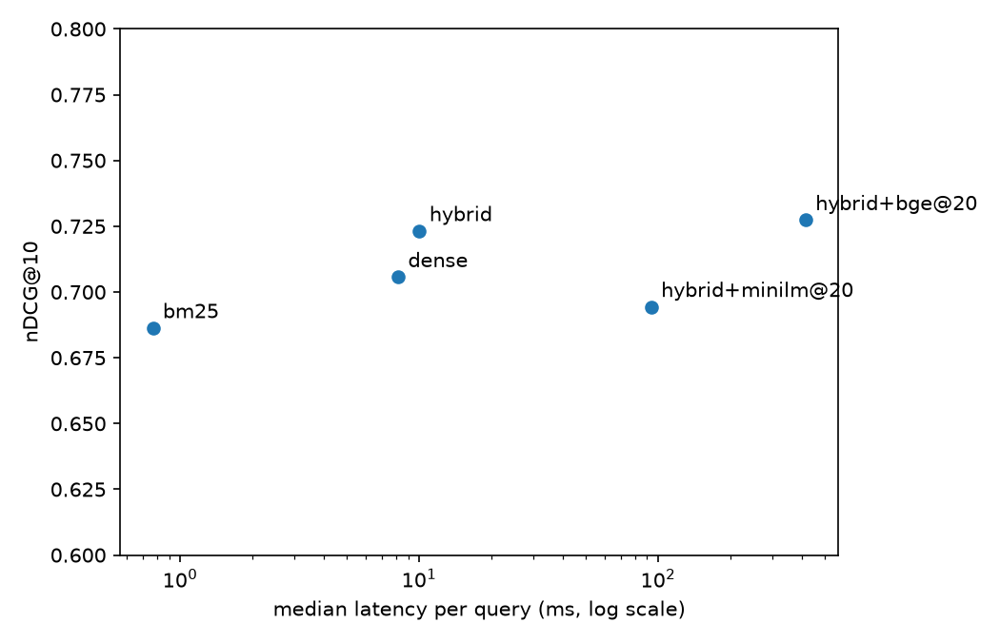

# scifact-retrieval-benchmark

BM25, dense, hybrid and reranked search compared on BEIR SciFact (5,183 abstracts, 300 test claims).
Hybrid search came out best. The two rerankers I tried didn't earn their latency.

I built this because in an earlier RAG project I picked "return the top 5 results" without ever
measuring it.

## Results

| system | recall@5 | recall@10 | nDCG@10 | median ms |
|---|---|---|---|---|
| BM25 | 0.736 | 0.819 | 0.686 | 0.8 |
| dense (bge-small) | 0.764 | 0.830 | 0.706 | 8.2 |
| hybrid (RRF) | 0.778 | 0.859 | 0.723 | 10.0 |
| hybrid + MiniLM rerank | 0.744 | 0.827 | 0.694 | 93.6 |
| hybrid + bge-reranker rerank | 0.796 | 0.853 | 0.727 | 414.0 |



Rerankers re-sort the hybrid's top 20. Latency is the median per query on an RTX 4050 laptop,
from a single run, so treat it as rough.

## What I found

- **Hybrid beats BM25**: +0.037 nDCG@10, bootstrap 95% range +0.019 to +0.056. This is the only
  gain I'd defend.
- Dense over BM25 (+0.019) and hybrid over dense (+0.018) are inside the noise with 300 queries. I
  can't claim either.
- **The MiniLM reranker hurt**: 0.723 down to 0.694 (range -0.055 to -0.003), at about 9x the latency.
- **bge-reranker-base added nothing**: +0.004 (range -0.019 to +0.029) at about 40x hybrid's latency.
  Reranking 50 or 100 candidates instead of 20 was slower and no better.
- The cutoff matters: hybrid recall goes from 0.778 at the top 5 to 0.889 at the top 20.

I don't know why the rerankers didn't help. My guess is that MiniLM was trained on web search, which
isn't the same job as matching a scientific claim to an abstract, but I didn't test that. It's two
models on one dataset, so this doesn't show reranking is useless.

## Where they fail

BM25 and dense miss different claims. Out of 300, 17 were found only by dense, 16 only by BM25, and
32 by neither. I read 15 of the failures. Dense wins when the claim and the abstract use different
words ("older appearance" vs "perceived age"). BM25 wins on rare names like CCL19. Both fail when you
need background knowledge, like aspirin and cyclooxygenase. These are 15 hand-picked examples with my
own labels, so it's a pattern I noticed and not a result. Notes are in
`results/error_analysis_notes.md`.

## How it was measured

The metrics (recall@k, MRR, nDCG) are my own code, checked against hand calculations, a random system
(about 0) and a cheating system that reads the answer key (exactly 1.0). The confidence ranges are a
bootstrap over the 300 claims, 1,000 resamples.

## Caveats

- One dataset, 300 claims, scientific text only.
- Unlabelled abstracts count as wrong, even if some are relevant.
- I didn't tune anything: one embedding model, RRF constant fixed at 60.
- I ran five bootstrap comparisons, so one could look significant by luck.

## Run it

```
pip install torch --index-url https://download.pytorch.org/whl/cu132
pip install ir_datasets bm25s PyStemmer sentence-transformers matplotlib numpy
python compare.py        # all five systems, writes results/results.json
python bootstrap.py      # confidence ranges
python make_report.py    # table and charts
```

Python 3.11. Models and data download on the first run. `config.json` holds the winning setup.

SciFact is released under CC BY-NC 2.0 (non-commercial). Data: Wadden et al. 2020, via BEIR.
